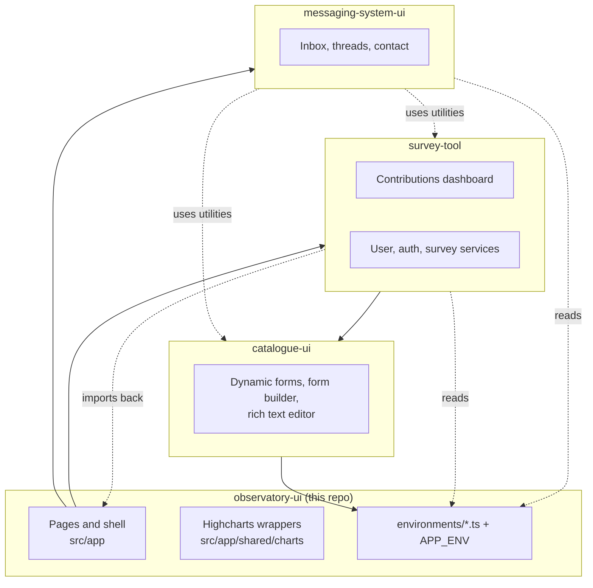

# Architecture

## Purpose and responsibilities

`observatory-ui` is the browser application of the EOSC Observatory. It is responsible for:

- public dashboards: country pages, country selector and landing pages, explore, EOSC readiness, archive;
- the authenticated contributions area (stakeholders, coordinators, administrators): surveys, news and stories,
  resources registry, messaging, user profile;
- the country-readiness report export (`.docx`, generated in the browser);
- embedding the Joomla CMS pages (about, resources, news) in an iframe.

**Out of scope.** The application stores nothing of its own and applies no business rules. Users, groups,
permissions, surveys, answers, documents, messages and statistics all live in the Observatory backend, which is the
authority for access control. Frontend guards only decide what to show.

## Structure

| Area | Location | Notes |
|---|---|---|
| Application shell, routing | `src/app/app.module.ts`, `app-routing.module.ts`, `app.component.ts` | NgModule-based bootstrap; some pages are standalone components |
| Public dashboard pages | `src/app/pages/{home,dashboard,country-pages,explore,eosc-readiness-dashboard,archive}` | Mostly lazy-loaded modules |
| Contributions extensions | `src/app/pages/dashboard/contribution-dashboard-extension` | Stakeholder, coordinator, administrator homes and news and stories, added on top of the survey-tool dashboard |
| Country page configuration | `src/app/pages/country-pages-configuration` | Per-country widget overrides, stored through the backend |
| Report export | `src/app/pages/report-creation`, `src/app/pages/services/report-creation.service.ts` | See its [README](../src/app/pages/report-creation/README.md) |
| Data access | `src/app/pages/services/*`, feature-local `*.service.ts` | `HttpClient` services; statistics queries are built in `data.service.ts` and `eosc-readiness-data.service.ts` |
| Charts | `src/app/shared/charts` | Highcharts wrappers (maps, bar, pie, sankey, treemap, gauges, report charts) |
| Shared UI | `src/app/shared/{top-menu,footer,cookies,pipes,reusable-components}` | Cookie consent gates Matomo |
| Static domain data | `src/app/domain` | Country lists, colours, captions, indicator tables |
| Environments | `src/environments` | One file per build configuration, see [configuration.md](configuration.md) |
| Submodules | `src/survey-tool`, `src/messaging-system-ui`, `src/survey-tool/catalogue-ui` | Each documented in its own repository |

Layering is: page component, then feature or shared service, then `HttpClient`, then `/api` (or an external
statistics service). Authentication, user state and the HTTP error interceptor are cross-cutting and are provided at
application level in `app.module.ts`.

## Routing

All routes are in `src/app/app-routing.module.ts`.

| Route prefix | Target | Frontend access check |
|---|---|---|
| `home`, `about/:selector`, `resources/:selector` | Home page, Joomla iframe loader | None (public) |
| `country-pages`, `country/:code/...` | Country selector and country pages | None (public) |
| `country/:code/configuration` | Country pages with override editing | No route guard; the component enables editing only for platform admins and `eosc-sb` coordinators/administrators |
| `explore` | Lazy `ExploreModule` | None (public) |
| `eoscreadiness` | Lazy `EoscReadinessDashboardModule` | Public, except `2021/investments` (`EoscReadinessGuard`) |
| `country_selector`, `landing/country/:code`, `archive/**` | Landing pages and lazy `ArchiveModule` | `ArchiveGuardService`: `eosc-sb` coordinators and `eosc-sb` stakeholder admins only |
| `contributions/:id/{contact,messages,...}` | Lazy `MessagingSystemModule` (contact form is public) | None at route level |
| `contributions/:id/{stakeholder,coordinator,administrator,news-and-stories}` | Role homes defined in this repo | `AuthGuard` |
| `contributions/:id/...` (dashboard, surveys, groups, support) | survey-tool's `ContributionsDashboardModule` | `AuthGuard` on every route |
| `reportExport` | Report creation | `AuthGuard` |
| `fb`, `fb/new-form`, `fb/:id/edit`, `invitation/accept/:token` | Form builder and invitations, registered by survey-tool through the empty-path fallback route | `AuthGuard` |
| `profile` | User profile (survey-tool) | None at route level |

## Composition of the submodules

The three submodules are not packages. They are compiled from source as part of this application, and
`angular.json` is what wires them in:

- **assets**: `src/survey-tool/assets`, `src/survey-tool/catalogue-ui/assets`
- **styles**: `src/survey-tool/styles/styles.less` before `src/styles/styles.less`; Less include paths contain `src/survey-tool/styles` and UIkit's Less sources
- **scripts**: UIkit, `sockjs.min.js` and `stomp.min.js` (the WebSocket client libraries are loaded as globals)

At runtime the host provides `APP_ENV` (the build's `environment` object) so that catalogue-ui reads its configuration
without importing the host. `src/survey-tool/environments/environment.ts` re-exports the host environment for the
same reason.

Dependency notes for maintainers:

- survey-tool imports from the host (`src/app/shared/shared.module`, `HomeComponent`, and `environments/environment`),
  and messaging-system-ui imports from the host environment and from survey-tool and catalogue-ui utilities. The
  submodules therefore cannot be built on their own. Only catalogue-ui is host-independent (it uses `APP_ENV`).
- Extension point: survey-tool supplies `StakeholderMentionableUsersProvider` for catalogue-ui's `MentionableUsersProvider` token
  (see `survey-tool.module.ts`).
- Changes to a submodule are committed in that submodule's repository, then the pointer is bumped here.

## Build configurations

| Configuration | Environment file | Notes |
|---|---|---|
| `development` (default for `ng serve`; used by `npm run watch`) | `environment.ts` | Unoptimised, source maps, no file replacement. `npm start` adds `proxy.conf.js` for `/api` |
| `beta` | `environment.beta.ts` | Optimised, hashed output, script source maps, bundle budgets |
| `production` (default for `ng build`) | `environment.prod.ts` | Same as beta, with runtime placeholders substituted by `init.sh` |

Bundle budgets (`beta` and `production`): initial warning 6.5 MB / error 10 MB; per-component style warning 10 kB /
error 20 kB.

## Persistence and client-side state

No browser database. State is held in services (RxJS `BehaviorSubject`s and signals), plus:

- `sessionStorage`: `userInfo`, the selected `currentStakeholder`/`currentCoordinator`/`currentAdministrator`, and
  `redirectUrl` for the post-login return;
- a first-party cookie with the visitor's cookie-consent choice (see [security.md](security.md)).

## Main data flows

1. **Public dashboards:** page component asks a service for a statistics query, the service calls
   `/api/statistics/raw?json=...` (survey data) or the OpenAIRE stats-tool (open-access indicators), and a Highcharts
   wrapper renders the response.
2. **Contributions:** the component calls the survey-tool services (`/surveys`, `/answers`, `/stakeholders`, ...); forms
   are rendered by catalogue-ui from a form model fetched from the backend.
3. **Messaging:** REST for threads and messages, plus a STOMP-over-SockJS connection for unread counts and
   notifications.
4. **Report:** charts are rendered on screen, converted to PNG, then merged with computed text into
   `assets/docx-templates/report_template.docx`.

## Authentication and authorisation

Authentication is a server-side session established through an OAuth2/OIDC redirect handled by the backend; the
frontend only checks `/api/user/info` and redirects to the login URL when needed. Roles (stakeholder, coordinator,
administrator) come from that response. Details in [security.md](security.md).

## Important constraints and decisions

- Single deployable artefact: the nginx image serves the static bundle and reverse-proxies `/api`, so the browser
  sees one origin. The production build contains runtime placeholders that the container fills in at start-up.
- The Joomla pages are same-origin through the nginx `/pages` proxy, which allows the iframe loader to exchange
  `postMessage` events with the embedded page.
- RxJS is pinned to 6.6 (`package.json`) while Angular is on 20; keep this in mind when adding RxJS 7 features.
