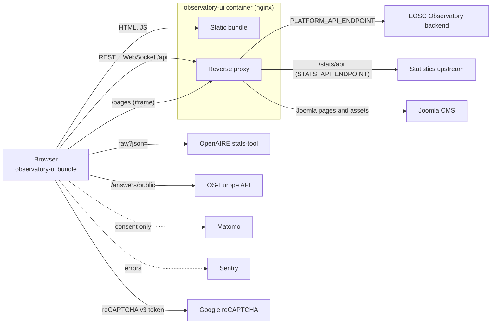

# Integration

The UI only calls out; nothing calls the UI except browsers (and the embedded Joomla pages, which send it
`postMessage` events). Endpoint paths, parameters and schemas are owned by the backend's Swagger/OpenAPI documentation;
this document lists the endpoint **groups** the UI depends on.

## Integrations

| # | Counterpart | Direction | Purpose | Protocol | Endpoint configuration | Authentication |
|---|---|---|---|---|---|---|
| 1 | EOSC Observatory backend | UI → backend (via nginx) | All application data, login, surveys, news, documents, messaging, dashboards | REST/JSON | `API_ENDPOINT`, `MESSAGING_ENDPOINT` (relative `/api`); nginx `PLATFORM_API_ENDPOINT` | Session cookie (`withCredentials`), XSRF header on writes; OAuth2 login via redirect |
| 2 | Backend WebSocket | UI ↔ backend | Unread counts and notifications (messaging); live edit, active users and comments on forms (catalogue-ui) | STOMP over SockJS | `WS_ENDPOINT`, optional `WS_TOPICS` | Session cookie; `X-XSRF-TOKEN` sent in the STOMP CONNECT headers |
| 3 | Survey statistics | UI → backend | Survey-based indicators for dashboards (`raw?json=`, `chart?json=`) | REST/JSON | `STATS_API_ENDPOINT` + `profileName` | Same session; no extra credentials |
| 4 | OpenAIRE stats-tool | UI → OpenAIRE | Open-access and open-science indicators (`raw?json=`) | REST/JSON | `OSO_STATS_API_ENDPOINT` + `osoStatsProfileName` | None |
| 5 | OS-Europe API | UI → OpenAIRE OS-Europe | Public answers and metadata for country pages | REST/JSON | `OS_EUROPE_API_ENDPOINT` | None |
| 6 | Joomla CMS | UI → CMS (via nginx `/pages`) | About, resources, news pages shown in an iframe | HTTP + `postMessage` | nginx `location /pages` and Joomla asset locations | None |
| 7 | Matomo | UI → Matomo | Page analytics | HTTPS | `matomoTrackerUrl`, `matomoSiteId` | Only after the visitor accepts analytics cookies |
| 8 | Sentry | UI → Sentry | Error reports, traces, session replays | HTTPS | `enableSentry`, `sentry.*` | DSN |
| 9 | Google reCAPTCHA v3 | UI → Google, token → backend | Protects the public contact form | HTTPS + `g-recaptcha-response` request header | `RECAPTCHA_V3_KEY` | Site key; verification of the token is up to the backend |
| 10 | Google Fonts, jsDelivr | Browser → CDN | Icon fonts and flag sprites loaded from `index.html` | HTTPS | Hard-coded in `src/index.html` | None |

> **Note on statistics.** The Angular `STATS_API_ENDPOINT` key (row 3) points at `/api/statistics/`, i.e. the backend
> through the `/api` proxy. The nginx `/stats/api` location and the container variable of the same name are not
> referenced by any environment file or source file: the application does not use them. They are kept on purpose, so that
> anything outside the application that still calls `/stats/api` keeps working. In the production deployment that route
> reaches the same backend statistics endpoint as `/api/statistics/`, so it is a second path to the same service. The cost
> is that the container variable stays required (see [configuration.md](configuration.md)). The route can be removed once
> the web server's access logs show no calls to `/stats/api`.

## Backend endpoint groups used

| Group | Used for | Where |
|---|---|---|
| `/user/info`, `/user/policies/*`, `/users/{id}/profile`, `/users/{id}/settings`, `/logout` | Session, profile, policy acceptance | survey-tool services |
| `/stakeholders`, `/coordinators`, `/administrators`, `.../users`, `.../managers`, `.../members` | Groups and membership | survey-tool services |
| `/stakeholders/{id}/news` (and `/public`) | News and stories | `src/app/pages/services/stakeholder-news.service.ts` |
| `/surveys`, `/answers/*`, `/csv/export/*`, `/invitation*`, `/permissions` | Surveys, answers and versions, invitations | survey-tool services |
| `/answers/public`, `/dashboards/{code}/types/*/groups/*/widgets*` | Country pages and widget overrides | `src/app/pages/country-pages/services` |
| `/documents*`, `/forms/models*` | Resources registry | `src/app/pages/explore/resources-registry/resource-registry.service.ts` |
| `/analytics/pageviews*` | Page-view analytics in dashboards | survey-tool `stakeholders.service.ts` |
| `/threads*`, `/inbox/*`, `/outbox/*`, `/groups`, `/threads/public` | Messaging | messaging-system-ui |
| `/statistics/raw`, `/statistics/chart` (as `STATS_API_ENDPOINT`) | Dashboard charts | `src/app/pages/services/data.service.ts`, `eosc-readiness-data.service.ts`, archive pages |

## Failure behaviour

- **No retries or timeouts on HTTP calls.** The UI does not retry REST requests and sets no client-side timeout;
  nginx's 300 s limit on `/api` is the effective one for the application, including its statistics calls
  (`/api/statistics/`). The 90 s limit on `/stats/api` applies only to callers of that route. Failures reach the calling component.
- **Global interceptor** (`src/app/pages/services/http-interceptor.service.ts`): `401` clears the cached user (the next guarded
  route triggers login); `403` shows a "no access" notification and navigates to `/home`; other errors are rethrown to the caller.
- **WebSockets** reconnect automatically: the messaging sockets retry every second for roughly two minutes and then
  every 10 seconds. Without the socket, unread counts do not update live; the rest of the page keeps working.
- **Statistics or OpenAIRE unavailable:** the affected charts stay empty; other widgets are independent.
- **Joomla unavailable:** the iframe pages are blank; the rest of the application is unaffected. The iframe loader
  accepts `postMessage` events only from the origins listed in `iframe-loader.component.ts`.
- **Matomo or Sentry blocked** (for example by an ad blocker): no effect on functionality.
- **reCAPTCHA unavailable:** the contact form still posts, but without the `g-recaptcha-response` header; the backend
  decides whether to accept it. A failed submission shows an error message above the Send button and is logged to the console.
